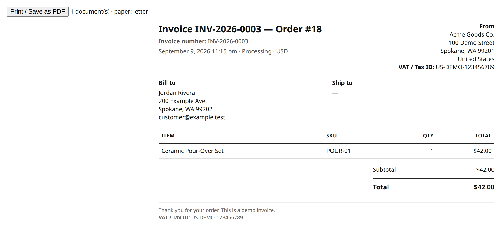
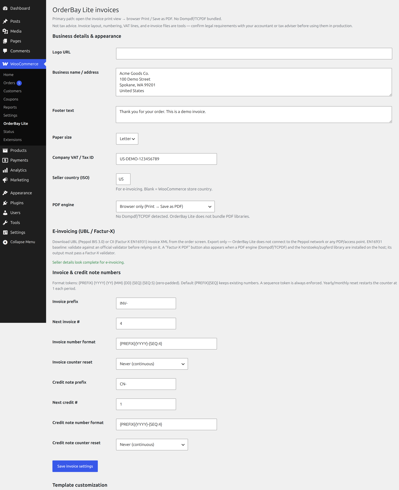
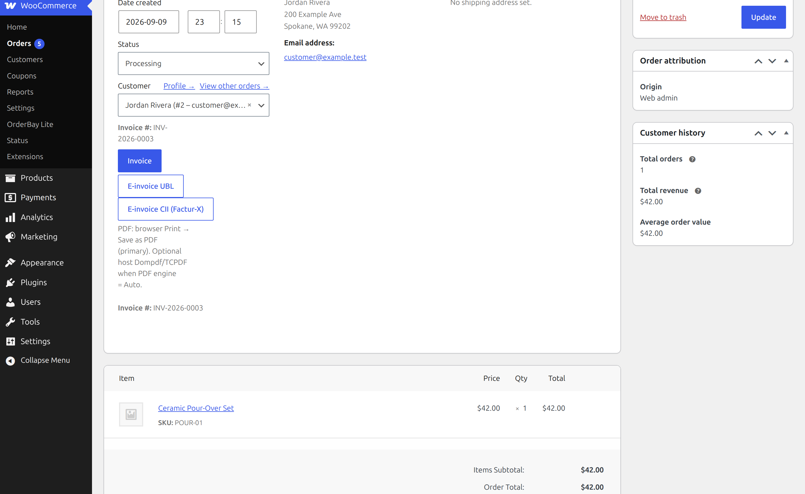
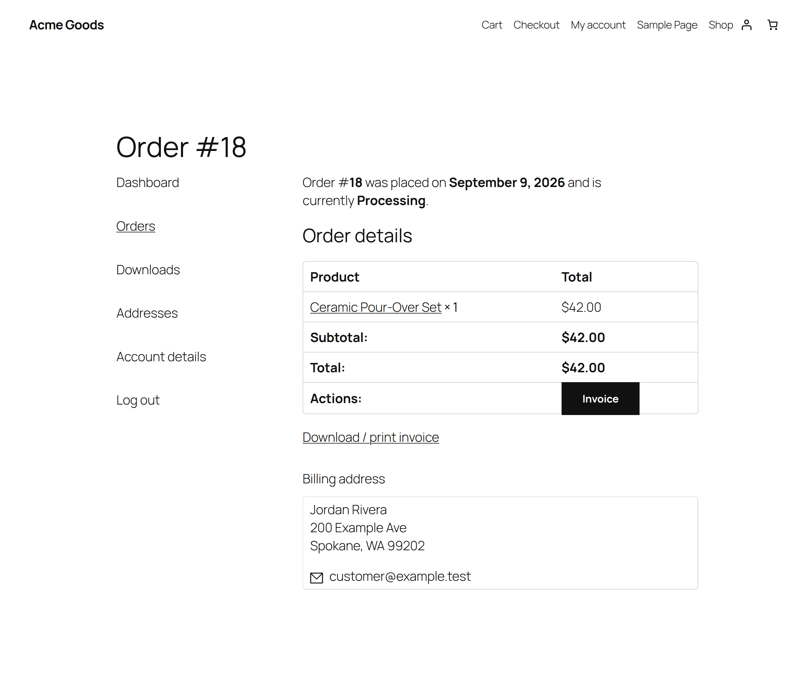

# OrderBay Lite

**Free WooCommerce invoices**: printable invoices, sequential numbers, credit notes, customer My Account download, and UBL 2.1 / Factur-X CII e-invoice XML.

No license key, no account, no phone-home. Free forever.

- Printable invoice for every order (browser Print → Save as PDF)
- Sequential, race-free invoice numbers (prefix, `{YYYY} {MM} {SEQ:5}`, yearly/monthly reset)
- Credit notes for refunded orders
- Customer invoice button on My Account → Orders
- UBL 2.1 (Peppol BIS Billing 3.0) and UN/CEFACT CII XML export
- Optional PDF download only if Dompdf/TCPDF is already on the host (not bundled)

Paid [OrderBay](https://tillpress.com/orderbay/) adds packing slips, delivery notes, labels, proforma, bulk print, barcodes/QR, branding, and a fulfillment desk. Lite is invoicing only and is never locked.

Author: [Tillpress](https://tillpress.com) (trade name of Alex Software Holdings LLC). Contact: info@tillpress.com.

## Install

**Use the Release zip, not GitHub’s “Source code” download.** WordPress needs a folder named `orderbay-lite`.

1. Download `orderbay-lite-1.0.1.zip` from [Releases](https://github.com/TillPress/orderbay-lite/releases/latest).
2. In wp-admin: **Plugins → Add New → Upload Plugin**.
3. Activate. WooCommerce must already be active.
4. Open **WooCommerce → OrderBay Lite** (settings) and fill business details.

Requirements: WordPress 6.2+, PHP 7.4+, WooCommerce 7.0+.

Not yet listed on wordpress.org. This GitHub Release is the installable zip.

## Setup

### 1. Business details

**WooCommerce → OrderBay Lite** (or the OrderBay Lite settings screen):

- Legal business name
- Address
- VAT / Tax ID
- Logo (optional)
- Invoice number format, for example `{PREFIX}{YYYY}{SEQ:5}` → `INV202600001`
- Yearly or monthly counter reset, if you want numbers to restart

Save.

### 2. Print an invoice

Open a WooCommerce order. Click **Invoice**. Use the browser **Print → Save as PDF**.

The first print (by staff or by the customer) assigns the next sequential number. Numbers are immutable after that. Two simultaneous prints cannot receive the same number.

### 3. Customer download

Logged-in customers get an **Invoice** button on **My Account → Orders** and on the order view. Only the order’s owner (or shop staff) can open it.

### 4. Credit notes

Refund the order in WooCommerce as usual. Open the credit note from the order screen. 1.0.1 lists each refund line (reason and amount); 1.0.0 only showed the total.

### 5. E-invoice XML

Order buttons: **E-invoice UBL** and **E-invoice CII (Factur-X)**. These are EN16931-baseline exports. Validate with an official EN16931/Peppol validator before production use.

A Factur-X PDF button appears only if the host already has a PDF engine (Dompdf/TCPDF) **and** the `horstoeko/zugferd` library. Lite bundles neither.

### 6. Optional PDF engine

Lite’s primary path is browser print. If Dompdf or TCPDF is already installed on the host, an optional Download PDF button can use it. Do not expect a bundled PDF library.

## Screenshots

## FAQ

### Is there a license key or trial?

No. Every Lite feature works without a key, trial, or phone-home.

### How do invoice numbers work?

Assigned on first print. Atomic counter in the database. Configurable prefix, tokens (`{PREFIX} {YYYY} {MM} {SEQ:5}`), optional yearly/monthly reset.

### Does it generate PDFs?

Browser Print → Save as PDF is the supported path. No PDF library is bundled.

### What if I also install paid OrderBay?

Lite steps aside so you do not get duplicate buttons or a second number sequence. You can deactivate Lite.

### Can I install from “Code → Download ZIP”?

No. Use the **Release** asset. GitHub’s source zip has the wrong folder name.

### Where do I get help?

Email **info@tillpress.com**. Paid documents product: [tillpress.com/orderbay](https://tillpress.com/orderbay/).

## License

GPLv2 or later. See [LICENSE](LICENSE).
